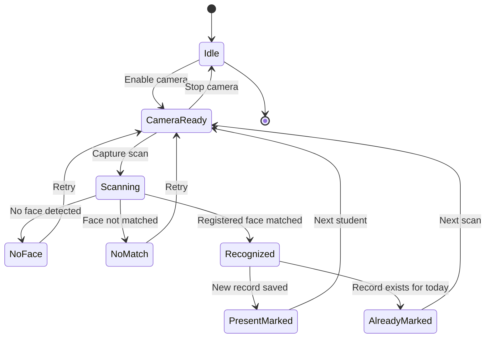
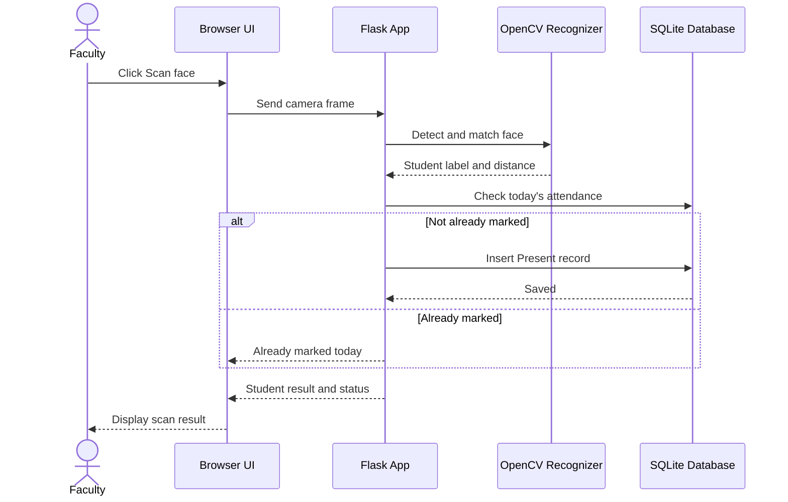

# UML and System Diagram Notes

Use these notes to draw polished diagrams in diagrams.net, StarUML, or another tool. They are a starting point; adapt them to your teacher's required notation.

## Use case diagram
**System boundary:** Smart Attendance Management System

**Actor:** Faculty / Administrator

**Use cases:**
- Register student
- Update/remove student
- Enroll face samples
- Start face scan
- View scan result
- Mark attendance
- View attendance by date
- Export attendance report

Relationships:
- “Start face scan” includes “Detect face” and “Match face against enrolled model”.
- “Mark attendance” occurs only after a recognized match.
- “Export attendance report” uses the selected date's attendance records.

## State diagram — Attendance session

## Sequence diagram — successful attendance scan

## Class / data model
- **Student**: id, roll_no, name, department, year, created_at
- **AttendanceRecord**: id, student_id, attendance_date, attendance_time, status
- One Student has zero or many AttendanceRecords.
- One AttendanceRecord belongs to exactly one Student.
- Face sample files are stored by student ID in the local data folder; the trained model is stored as a local OpenCV model file.

## DFD Level 0 (context)
External entity Faculty → Smart Attendance System → attendance report.
The system receives student details and camera frames; it stores student data, face samples/model, and attendance records locally.

## DFD Level 1 (processes)
1.0 Manage Students → Student Database
2.0 Enroll Face → Face Samples / Trained Model
3.0 Recognize Face → Trained Model
4.0 Record Attendance → Attendance Database
5.0 View / Export Report ← Attendance Database

## Activity flow
Start → Select student / open scan → Enable camera → Capture frame → Face detected?
- No → show retry message → capture again
- Yes → face matched?
  - No → show no-match message → retry
  - Yes → already marked today?
    - Yes → show already-marked status
    - No → save attendance
→ Display result → End
